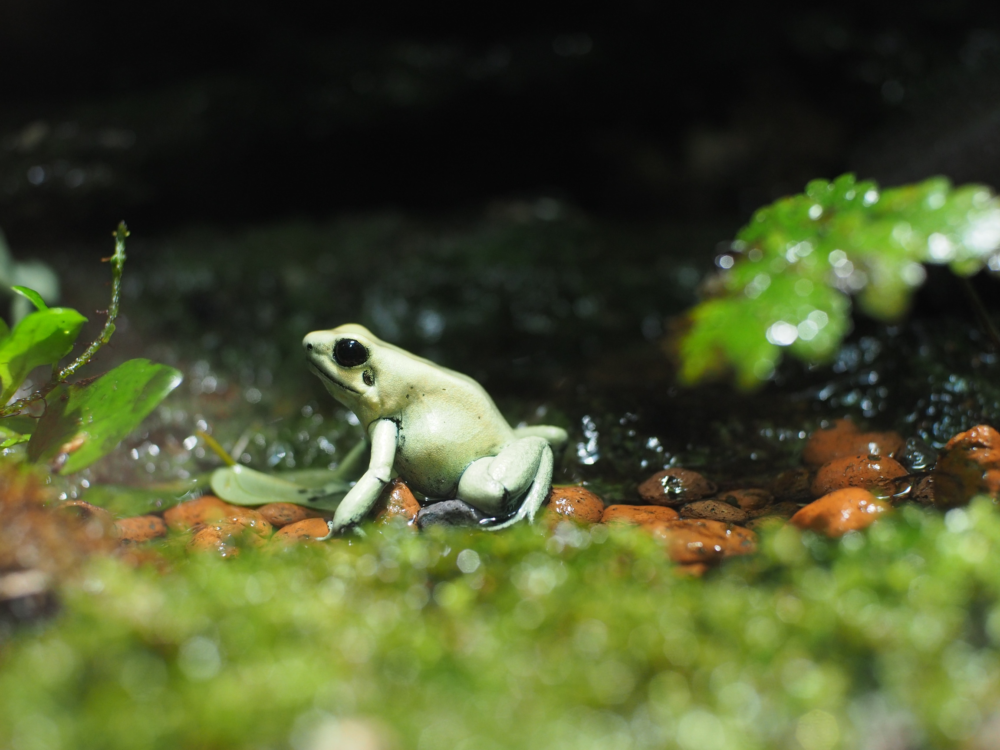
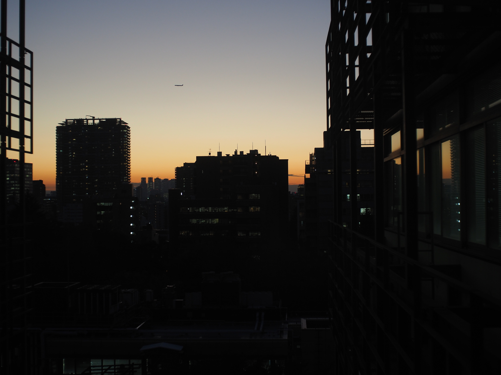

# ミラーレス一眼のある生活 (買ってから半年、2nd review)

日記だよ

ミラーレス一眼カメラ E-M5 Mk.II を買って、半年以上経ったらしい はやいね〜
[前回の記事はこちら](/posts/my_new_gear_em5m2)

## 半年間の変化

### 趣味としてのカメラ？

> 写真をガチ趣味にするつもりはあんまりなくて、

こう言いましたが…

魂売るほど熱中はしてないけど、毎日持ち歩いてたくさん撮ってあそんでいる
写真のための旅行欲が発生しはじめた

カメラといえば、で撮れるものひととおり撮って遊びきって、熱が落ち着いたところ

ライブラリには5400枚データが貯まりました

### 高いカメラへの解像度

しばらく界隈の話読んで・聞いていると、主要メーカーの雰囲気とか、最新機の強みとか、がわかるようになってきた
いま同じ予算でカメラ買うとして同じ選択するかというと、しない気がする。でも今のに不満はないし、所有して入門したからこそアンテナが育ったんだろうなーと思っている

### レンズは生えてくるもの

レンズってマジで生えてくるんですね、知らなかった。望遠と単焦点が増えたよ

今のデッキ
- M.ZUIKO DIGITAL 14-42mm F3.5-5.6 II R
- M.ZUIKO DIGITAL ED 40-150mm F4.0-5.6 R
- TTArtisan 25mm f/2 C APS-C

MF単焦点が楽しすぎる、毎日持ち歩くときはこれをつけています
これだと、絞りを物理リングで操作して、SモードでSSと露出補正を調整する、という運用ができて完璧
AFなくても動き物(except 人間)あんまり撮らないから困らないらしい フォーカスピーキングと拡大プレビューがあるのは助かる

お高めのレンズ(12-45mm F4.0)もそのうち買いたいなー 旅行とかにはぴったりだと思ってる
単焦点の楽しさで欲がいったん満たされたので、だいぶ先になる予感

## DIYしたい、してない

レンズ自作したーい、と言い続けて結局やってない
(津万利とどさんに強く影響を受けた でも指咥えて動画見てるだけ…)
レンズ磨きも鏡筒自作もやりたいんだけどなー
3Dプリンタとかが家にあれば事情は変わってくるのでしょうか…

超超望遠レンズとか、買うより作ったほうが楽しそう、野鳥とか撮るわけじゃないし… でも手は動いてない

## スマホカメラとの使い分け

晴れて(?) Galaxyが2年レンタル期間を終え卒業、5月に(宣言どおりカメラを捨てて安いのを選び)Pixel 10aをお迎えしました。
どっちにしても開口が小さくてボケもノイズも微妙なんよな
いや、後処理がずいぶん頑張ってると評価するべきかも()

1/2in Quad PDセンサで、Bayer画像さえ得られない(でも12MPあるのね)。 4/3とのセンサ面積比は4段分。…まーそんなもんか

毎日持ち歩いてるし、時間がないとかでない限りは一眼を使っています

## 撮って出しJPGと現像

### AIノイズ除去すごいね
旧来のアルゴリズム(waveletとかNLM)の時点ですげ〜って言ってたのに、AIのやつはノイズを減らすどころか消してるよね、あれほんとにすごい さすが生成AIって感じ(てきとう)
OSSしか信用してない(当然Adobe製品なんか使えない)ので、フリーのモデルで実験して、RawForge(TreeNetDenoise)が採用された (ところで BayerではなくRGB入力なのに(?)性能が他よりよさそう、おもろい)
ISO感度5000[^iso-noise][^iso-mft]くらいでも見るに耐える絵が出てきてびっくりしちゃった スマホできれいな写真が撮れるのもこういうことかー

[^iso-noise]: 普段「ショットノイズは感度と関係ない、ISO感度をノイズ量の指標に使うな」委員やらせてもらってるんだけど、でも「この感度で適正露出になる露光環境」を示す表現を考えるとこれでいいやってなっちゃった。くやしい…
[^iso-mft]: 12MPで4/3センサで現れるノイズ量のことですね。同解像度のFFなら2段分暗い状況に相当するはず。ショットノイズは絶対光量に依存するから

### 保管と現像

閲覧用にはimmichを使用、google photosを卒業した。

ついでに、PCで現代のアルゴリズムと計算能力で殴ったほうが性能出るっしょ、いうことで、撮って出しJPGをやめて、全部PCで現像することにしてみた、のがつい最近。この運用で半年くらい
AI denoiseもこれに組み込もうかな～って思っている

手動でdarktable現像することもあるが、ほんの一部。1%くらいかな

## まとめ

案外どっぷりカメラ趣味に浸かってしまった
楽しいのでみんなやろう(適当)
(カメラ買ったウキウキを過ぎた後も楽しむには、いくらくらい初期投資が要るんだろう…?)

## おまけ
写真の1枚もないの寂しいよね

:::image-inline

:::

